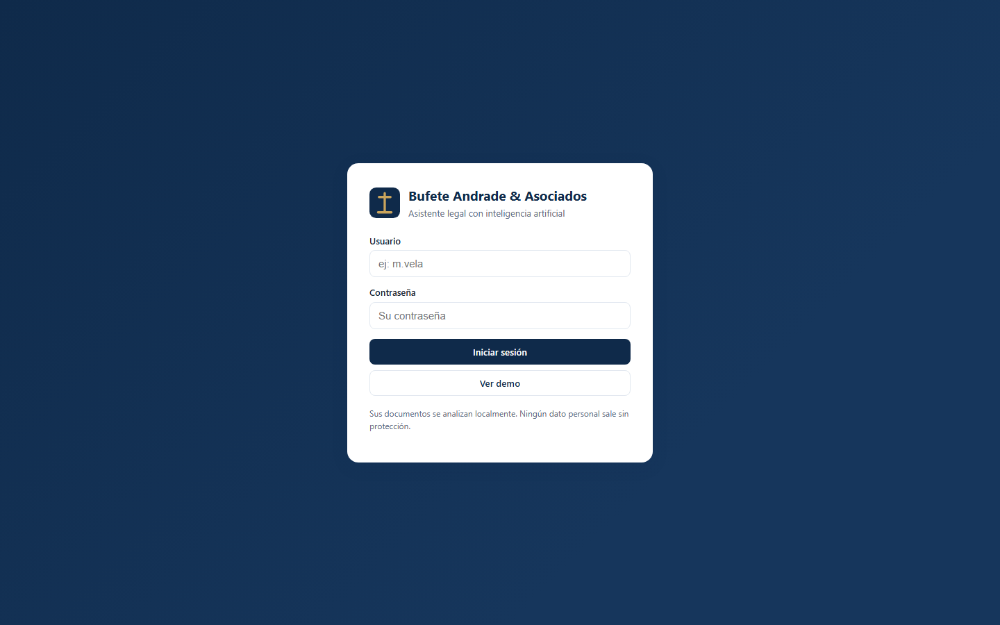
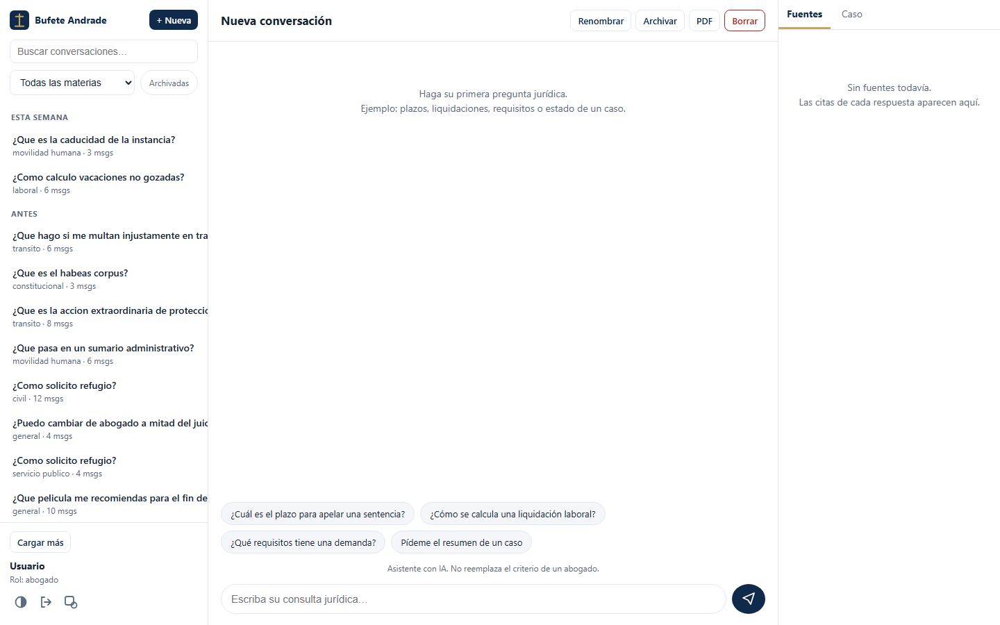
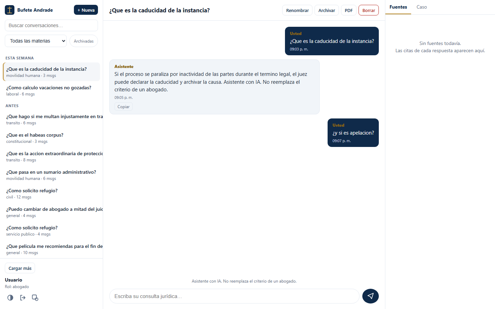
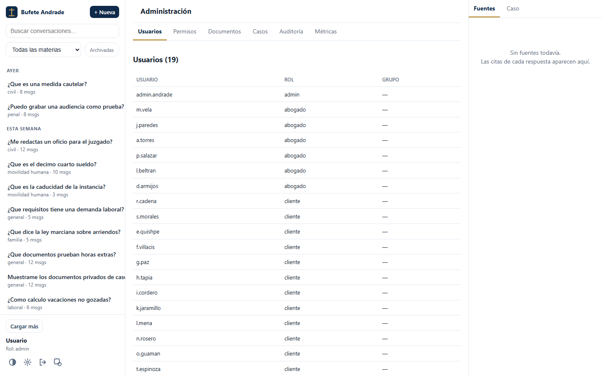
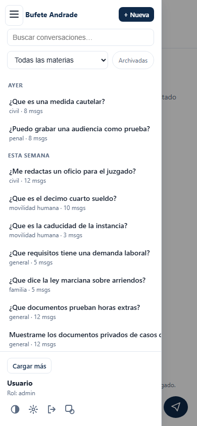

# LegalRAG — Asistente con IA para bufetes de abogados

> Búsqueda semántica + RAG sobre documentos legales. Embeddings 100% locales,
> razonamiento externalizado (SenseNova / Seek / OpenRouter) solo con texto
> previamente ofuscado. Interfaz web propia, sin frameworks.



## Arranque en 1 comando

> **Página local profesional: http://localhost:8000** (API + interfaz web
> en un solo servicio Docker; el Streamlit de `frontend/` queda como legacy).

```bash
cp .env.ejemplo .env   # completar SECRET_KEY_JWT (>=32 chars) y la API key
docker compose up -d --build   # o doble clic en iniciar_legalrag.bat
```

La demo se siembra sola en el primer arranque (`AUTO_SEMBRAR_DEMO=1`,
idempotente; tarda unos minutos la primera vez porque descarga el modelo
local de embeddings). Login demo: `m.vela` / `demo-2026`
(admin: `admin.andrade` / `demo-2026`).
Si el puerto 8000 lo ocupa otra app: `PUERTO_HOST=8081 docker compose up -d`
y abrir http://localhost:8081.

Sin Docker:

```bash
cp .env.ejemplo .env
python scripts/sembrar_demo.py --reset
uvicorn backend.main:app --port 8000
```

Sin `SECRET_KEY_JWT` válida la app **no arranca** (fail-fast de seguridad).

Scripts: `iniciar_legalrag.sh` / `iniciar_legalrag.bat` (Docker → :8000),
`iniciar_saas.sh` (legacy: backend + Streamlit sin Docker).
Detener todo: `docker compose down` (los datos de `backend/db/` persisten).

## Usuarios demo (tras la siembra)

Contraseñas solo para demo. Datos 100% ficticios.

| Usuario | Rol | Clave |
|---|---|---|
| `admin.andrade` | admin | `demo-2026` |
| `m.vela`, `j.paredes`, `a.torres`, `p.salazar`, `l.beltran`, `d.armijos` | abogado | `demo-2026` |
| `r.cadena` … `t.espinoza` (12 clientes) | cliente | `demo-2026` |

Demo incluida: 25 casos, 200 conversaciones (últimos 90 días), 3 textos
legales de demostración en el vector global.




## Qué hace

- **Chat con streaming en vivo**, citas clicables, copiar, sugerencias,
  aviso fijo ("Asistente con IA. No reemplaza el criterio de un abogado").
- **Burbuja flotante** arrastrable con no-leídos; recuerda si quedó abierta
  o minimizada. Widget incrustable en cualquier web con una línea:

  ```html
  <script src="http://localhost:8000/widget.js" data-base="http://localhost:8000" defer></script>
  ```

- **Permisos por usuario/grupo × documento/colección**, filtrados *dentro*
  de la búsqueda vectorial. Sin permiso: denegación sin filtrar texto.
- **Artículos completos y literales**: corte por artículo en ingesta,
  recuperación exacta ("dame el artículo 54 del Código de Trabajo"),
  continuación automática ante cortes, verificación anti-invento.
- **Panel admin** (solo `admin`): usuarios, matriz de permisos con
  interruptores, documentos (subir/borrar), casos, auditoría y métricas
  (consultas/día, temas, documentos citados).

  

- **Conversaciones**: buscador, filtros (materia/caso/fecha), agrupadas por
  Hoy/Ayer/Esta semana/Antes, renombrar, archivar, exportar a PDF.

  

## Arquitectura

```
navegador ──→ FastAPI :8000 ──┬──→ SQLite (usuarios, casos, convs, auditoría)
   (UI propia /)              ├──→ ChromaDB + sentence-transformers (local)
                              └──→ LLM OpenAI-compatible (SenseNova/Seek/OpenRouter)
```

- Un solo contenedor expone la app (`backend`, `:8000`). El volumen
  `./backend/db` persiste SQLite + ChromaDB entre reinicios.
- Proveedor: `LLM_PROVEEDOR` (`sensenova` → `https://token.sensenova.ai/v1`,
  `seek` → `https://100milionseek.top/v1`, `openrouter`, `hms`, `custom`).
  Key por prioridad: `LLM_API_KEY > SENSENOVA_API_KEY > SEEK_API_KEY >
  HMS_API_KEY > OPENROUTER_API_KEY`.
- Regla de oro: ningún texto crudo con PII sale sin `ofuscar_texto()`
  (incluye cédula/RUC/teléfono de Ecuador). Solo la pregunta ofuscada se
  audita.

## Decisiones

- Vanilla HTML/CSS/JS sin frameworks: cero build, servido por FastAPI.
- Permisos con `where` nativo de ChromaDB (el texto prohibido nunca llega a Python).
- Denegación canned sin LLM (determinista, testeable, sin filtración).
- Citas literales con temperatura 0 y verificación contra el texto guardado.
- Streamlit legacy se conserva pero ya no es la UI principal.

## Límites conocidos

- Umbrales RAG calibrados en demo (`RAG_UMBRAL_RELEVANCIA=0.55`, etc.).
- Rate limit en memoria (un proceso). Auditoría admin con prefijo `[ADMIN]`.
- BDs anteriores a Fase 2/F no reciben las columnas/tablas nuevas
  (re-sembrar). Cambiar el modelo de embeddings invalida los vectores.
- Evals: 20 casos (5 base + 15 G2); meta ≥85% pendiente de corrida con LLM real.
- El chat RAG no consulta la tabla `casos` con SQL (los filtros exactos
  viven en `GET /api/casos`).

## Tests

```bash
python -m pytest tests/ -q   # 212 tests en verde, todo con mocks (sin red ni gasto)
```
