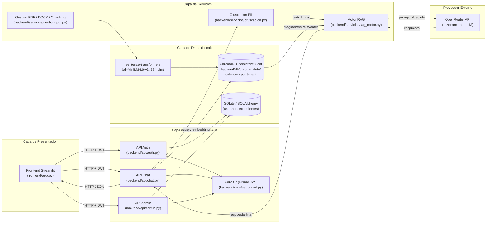

# Mapa de Arquitectura - LegalRAG_SaaS

> Documento vivo que describe como se conectan los componentes del sistema multi-tenant para firmas de abogados. La intencion es que cualquier nuevo desarrollador entienda el flujo de datos en menos de cinco minutos.

## 1. Vision General

LegalRAG_SaaS es una plataforma **multi-tenant** que combina:

- **Frontend Streamlit** para la experiencia del abogado (UI conversacional y carga de PDFs).
- **Backend FastAPI** que orquesta autenticacion, logica de negocio y la cadena RAG.
- **Embeddings y vector store 100% locales** (sentence-transformers + ChromaDB) para mantener la confidencialidad de los expedientes.
- **LLM externo via OpenRouter** unicamente para el razonamiento final sobre texto previamente ofuscado.

**Motor Vectorial implementado con ChromaDB y sentence-transformers (`all-MiniLM-L6-v2`). Aislamiento multi-tenant validado mediante colecciones separadas por ID de usuario.**

La **Regla de Oro** es: ningun texto crudo con datos personales sale del backend sin pasar por el modulo `servicios/ofuscacion.py`.

## 2. Mapa Mental (Mermaid)

## 3. Flujo End-to-End de una Pregunta

1. El abogado inicia sesion en Streamlit. El frontend obtiene un **JWT** desde `POST /auth/login`.
2. El abogado carga un PDF. El frontend lo envia a `POST /admin/expedientes` y el backend lo trocea con `servicios/gestion_pdf.py`.
3. Los chunks pasan por `sentence-transformers` (en el mismo proceso) y se persisten en **ChromaDB** etiquetados con el `id_tenant`.
4. El abogado formula una pregunta. Streamlit la envia a `POST /chat/preguntar` con el JWT.
5. El backend valida el token, identifica al tenant y aplica **`ofuscar_texto()`** a la consulta antes de cualquier llamada externa.
6. El embedding de la consulta (ya limpia) consulta a ChromaDB por similitud coseno, filtrada por tenant.
7. El prompt final = `contexto_relevante + consulta_ofuscada`. Solo entonces se llama a OpenRouter.
8. La respuesta vuelve al backend, se registra en SQLite y se entrega al frontend.

## 4. Principios de Diseno

| Principio | Aplicacion |
|---|---|
| Aislamiento de datos | Cada tenant tiene su propia coleccion en ChromaDB (`casos_user_<id>`); Tier 1 (leyes) vive en una coleccion global `leyes_globales` consultable por todos. |
| Defensa en profundidad | Ofuscacion PII se aplica en backend, antes de cualquier I/O de red. |
| Bajo costo | Embeddings y vector store corren local; el unico costo variable es el LLM. |
| Testabilidad | Cada servicio expone funciones puras testeables sin red (ver `tests/`). |
| Secretos fuera de VCS | `.env` ignorado por Git; `.env.ejemplo` documenta la configuracion. |

## 5. Estructura de Directorios (resumen)

- `backend/` - Codigo del servidor FastAPI, organizado por capas (api, core, db, servicios).
- `frontend/` - Aplicacion Streamlit que consume la API.
- `tests/` - Suite pytest (TDD). Cubre ofuscacion, endpoints y motor RAG.
- `docs_ia/` - Memoria del proyecto: arquitectura, gobernanza, decisiones tecnicas.
- `mapa.md` - Este archivo: vision global y diagrama.

## 6. Referencias Internas

- [Arquitectura detallada](./docs_ia/01_arquitectura.md)
- [Gobernanza y PII](./docs_ia/02_gobernanza.md)
